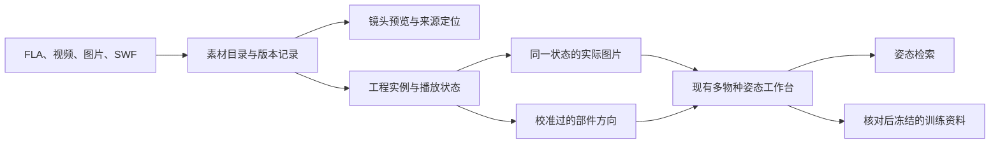

# 原始素材接入姿态检索：素材目录、工程方向与训练参考

2026-10-11，接续同日初探，按多物种工作台的实际实现更新。**状态：探查已完成，下面的接入功能是 AI 建议，尚未实施；用户本轮委托的是探查与规划。** 已确认的标注规则继续有效。

证据：[本轮验证记录](../开发/验证记录-2026-10-11-素材文件接入探查.md)、[初探记录](../开发/验证记录-2026-10-11-原始动画素材探查.md)、[现有工作台说明](../docs/pose-library-v2.md)。原素材目录为 `D:/活/AE/素材/泄露素材`，本轮只读。

2026-10-12 接续：用户进一步明确多格式方便编目、结果方便定位原文件和帧。具体接口、结果交互、格式能力及实施次序见[多格式编目与结果定位详细规划](方案卡-2026-10-12-多格式编目与结果定位.md)。首版优先打通目录、视频/图片姿态、搜索到原素材的流程，同时纳入 FLA 文件级定位；本文的工程方向路线在其后小批验证。

## 推荐做什么

**先让素材能查、能预览、能回到来源，再验证从工程取得方向，最后才批量生成训练参考。** 三步共享同一份素材目录，不另造一套姿态算法。

最重要的收益是减少反复逐图标注：对于反复出现的同一种角色画法，先确认一次“这条箭头代表什么”，后续由工程变换带着箭头移动。代理准备叠加图和异常队列，用户集中审核代表状态。能省多少工作尚待实测，文件数量不等于可用标签数量。

目录里的一份 FLA 可以还没有姿态。一张图片中的一个角色才是一份姿态观测；同一帧中的多个角色分别登记。

## 素材规模与支持边界

清单复核为 15,486 个文件、52.95 GiB，大小和修改时间与初探一致。

| 素材 | 已看到的情况 | 第一轮用途 | 后续条件 |
|---|---|---|---|
| FLA：6,791 | 3,112 个 ZIP/XML；3,679 个旧 OLE | 全部登记；现代格式提取主文档、库目录、存储关键帧 | XML 可读不代表播放状态已还原；旧格式先登记，后在工作副本上小量转换 |
| 镜头 FLA：3,154 | 1,516 个现代格式、1,638 个旧格式 | 镜头和工程位置索引 | 沿实际实例的嵌套时间轴取状态，不把整个元件库当已演出的动作 |
| 角色设计 FLA：638 | 273 个现代格式、365 个旧格式 | 模板、参考画法和校准候选 | 不是每个文件都有可复用完整角色；同名文件区分内容版本 |
| MP4：1,138 | 全在 ReviewQT；初探找到全部同名镜头 FLA 候选 | 预览、选帧、图片标注入口 | 同名先记候选，逐帧对齐另验证 |
| JPG：6,451 | 5,652 张 96×54；797 张 192×108；2 张 3600×2025 | 小图导航；两张大图作为图片候选 | 不将缩略图扩大后当清晰训练图；大图仍需分角色与审核 |
| MOV：391 | 都在镜头目录；初探抽到的 214/001 是黑白分镜 | 经实际内容确认后标“分镜/预览/其他” | 不按扩展名视为最终画面或绑定 FLA 帧号 |
| SWF：715 | 714 个有同目录同名 FLA；仅检查头和关联 | 保留关联，供以后检查历史导出 | 首轮不承担姿态提取；独立读取是否值得取决于 FLA 路线缺口 |

两张大 JPG 为 `214/SceneSetups/MLP214_092.jpg`、`MLP214_177.jpg`，已看过，都是多角色彩色合成场景。目录里没有独立 `.xfl` 文件；现代 FLA 中有 XML。独立 XFL 文件夹可作未来接口，不宣称本轮已验证。

## 本轮改变规划的发现

1. **有真实多物种入口。** `925/016` 预览中可见穗龙和无序，工程含 `~SK_Character`、`~DCD_Character`；`925/020` 可见无序全身；`925/012` 可见提雷克。名称和画面仍需对齐到具体实例。
2. **狮鹫尚没有确认可用的完整绑定。** 全部 3,112 个现代主文档的名称检索找到两处 `gabby` 线索；深入检查 `922/067Z`，三个相关部件由背景照片路径中的 `Gaby_Pic_pic` 引用。抽看的预览没有确认前景狮鹫。不代表全目录没有狮鹫，旧格式和缩写尚未穷尽；首批不依赖它。
3. **同名不等于同模板。** 638 个角色文件有 561 种不区分大小写的文件名。39 组重复名称涉及 116 个文件，逐文件哈希后，32 组含不同内容；6 个同名公主暮光文件全部不同。文件名不能充当模板版本；字节相同也不能直接定义训练时的“复用素材族”。
4. **图层名不是部位真值。** `813/002` 中名为 `TS*Tail` 的图层引用 `PTS_Neck`，前腿名称的图层可引用鬃毛。应记录实际元件及实例层级，再校准方向含义。
5. **预览和工程可能差帧。** `925/020` 主时间轴 106 帧、MP4 107 帧，视频末帧近黑。这不是所有镜头通用的固定偏移；帧数相同也不证明逐帧一致。
6. **工程不只有刚性纸片旋转。** 代表文件有运动/形状补间、遮罩、镜像、非等比例缩放及不同播放模式，`925/020` 还有 camera 图层。单取角度或线性插值关键帧矩阵不能保证还原画面方向。

## 怎样接现有数据结构

工作台已能登记图片、记录不同身体结构的方向、审核、保存修订、检索和导出训练快照。它接受工程证据字段，但**尚无素材目录、实际证据解析器、FLA 播放还原或图像对齐器**。填写 `alignment_ref` 字符串不等于程序验证了它指向的事实。

建议新增来源模块，持久化放 `data/source_catalog_v1/`；派生图片、工作副本、渲染中间物放专用生成目录；正式姿态继续走 `data/pose_library_v2/`。下列是拟议记录，当前尚不存在。

| 记录 | 回答什么 | 核心约束 |
|---|---|---|
| `source_file / source_version` | 在哪、哪一版 | 根目录别名、相对路径、大小/时间；解析前取得 SHA-256。内容与位置分开，同内容可有多个位置，变更不覆盖旧证据 |
| `media_link` | 视频可能对应哪个工程 | 两端版本、关系类型、发现方式、候选/核对状态。正片时间戳另做关系，不从镜头号猜分钟数 |
| `instance_state` | 哪个角色实例、哪个状态 | 工程版本、场景、父子路径、图层/元素索引、实际元件、主帧及各级局部帧、播放模式。原始 ID 有则保留；不能只用重复图层名定位 |
| `rig_calibration` | 部件怎样变成箭头 | 身体定义版本、元件及依赖指纹、适用画法/局部帧范围、本地方向或辅助点、语义、核对记录。不按同名自动复用 |
| `render_alignment` | 图是不是这个状态 | 输入版本、渲染方法/版本、图片哈希、角色出现编号、工程到画面/裁剪的变换、核对证据。视频帧号/时间戳独立保存 |
| `extraction_job` | 做到哪、哪里失败 | 输入版本、工具能力、进度、逐文件错误、输出指纹、可重试阶段。目录成功不能当姿态成功 |

程序统一存从 0 开始的帧号，Animate 接口/界面若从 1 开始，只在适配边界转换。局部帧与主帧不能混用；工程缺帧率时记未知，不把视频的 24000/1001 填回工程。

同一角色、同一状态的场景图和单体图共享角色出现编号，使用各自图片与坐标变换。工程验证过存在且能取得完整角色后，沿用用户决定：即使合成画面遮挡它，也按完整角色参与检索；画面可见性仍分别记录。不能用“库里有条腿”替代完整角色验证，也不能借用另一帧的完整角色。

导入边界必须解析这些引用，检查版本、图片哈希、出现编号和变换，再写入现有 `source`、`evidence`、`asset_access`、`split_groups`。旧图片观测不必强制补工程来源。

## 从工程取得方向

先选身体定义。小马延用已有定义；穗龙检验双足龙草案；无序按真实鹰爪、狮爪、山羊腿、蜥蜴腿及两种翅膀修订专用定义。**现有混合身体是一个示例，不代表全部混合角色。** 提雷克另需上下躯干、两臂、四腿，不能把双臂塞进前腿位置。不同身体只能按明确含义比较相容的部分。

每一种可复用画法，在部件本地坐标中确认箭头或两端参考位置。两点可以只用于校准、审核，最终存方向：

- 同一刚性部件内的方向 `u`：用最终二维变换的线性部分 `A` 计算 `normalize(Au)`，平移相消。
- 两端属于不同部件：分别变换两个参考点，再相减并归一化。
- 形状补间/换图：旧映射未必适用，需要相应画法的校准或经核对的实际状态；未支持时留未知。
- 镜像、斜切、非等比例缩放都应反映在最终画面方向中。视角、角色身份、部位存在性不能直接从旋转角推出。

尾巴仍表示从身体伸出的初始方向；腿根在身体连接区域中间，后躯中心在两后腿之间。兼容整腿默认可交换、原始身份保留，整体翻转默认关闭。参考点不是训练必填项，新增物种不强制采用 14 个方向。

仅采样场景实际使用、可达的状态。`925/016` 主场景 459 帧而 `~SK_Character` 保存 698 帧，后者不能直接算成 698 张穗龙演出图；必须按父子播放关系取值，排除未用备选画法。

## 实现路线比较

| 办法 | 收益 | 代价与最坏情况 | 建议 |
|---|---|---|---|
| 视频/图片优先，配工程来源 | 最快接工作台，先查素材和辅助标注 | 仍从图片识别方向，遮挡部位不能自动解决 | 第一阶段及长期回退入口 |
| 离线目录＋Animate 实际渲染＋有限模板校准 | 有望减少重复标注，可回到可编辑工程 | 原生能力需验证；错映射会扩散到很多帧 | **推荐主线**，原生缺口不阻塞目录 |
| 自行完整实现 FLA/SWF 播放渲染 | 理论上可脱离原生应用批处理 | 嵌套、补间、遮罩、相机兼容工作很大，可能迟迟得不到可靠方向 | 本轮不选，仅解析已验证子集 |

当前会话没有可调用的 Animate MCP。相邻 `animate-mcp` 项目有离线编译及预览接口源码，但 README 明确原生验证未完成、未接日常 MCP；`inspect` 不能据此当作任意帧补间后的矩阵读取器。后续须独立验证原生渲染入口；本轮没有安装扩展、恢复其暂停测试或更改客户端配置。

能导出 PNG 也不代表已能提取正确方向。先确认简单实例的实际局部帧和矩阵，再加入复杂能力；失败时保留实际图像，走待审图像标注。能力清单写明支持范围，超出范围的状态明确停在相应阶段。

## 分阶段交付和验收

### 一、素材目录与预览入口

投入较小，独立有用，不依赖原生 Animate。

- 增量扫描；现代 FLA 提取主文档/库目录，旧格式保留待处理状态。
- 按剧集、镜头、用途、格式能力筛选；元件名称与角色身份分别展示。保留缩略图、视频候选、缺配套项和版本差异，设计素材与镜头分开筛选。
- 从视频选帧，选定一个角色后登记到工作台；自动身份、裁剪和方向都是待审。
- 结果可定位原文件、实例路径与局部帧；后续编辑使用副本。

验收：重复扫描不重复登记；源内容变化生成新版本并使旧缓存失效；32 组同名异内容不误合并；错误文件不阻塞其他项；候选关联不显示已对齐；不覆盖当前姿态库。

### 二、小样本工程方向验证

主要投入和不确定性在这里。以下是候选，不是已得到的标签。

| 候选 | 用途 | 限制 |
|---|---|---|
| `823/design/character/stk_c01_twilight_sparkle.fla` | 独角兽校准参照 | 设计画法不等于镜头状态 |
| `813/scenesetups/MLP813_002.fla` | 首个短镜头，嵌套与公主形态 | 初探约 2 秒、48 帧，先解决这一例 |
| `925/scenesetups/MLP925_016.fla` | 穗龙、无序部件及局部方向 | 抽样主要近景，未取得完整单体前只做局部 |
| `925/scenesetups/MLP925_020.fla` | 无序全身、不对称肢体 | 人物重叠且多一近黑末帧，放在首例成功后 |
| `925/scenesetups/MLP925_012.fla` | 提雷克的后续案例 | 两臂四腿定义就绪后再提取 |

从前几个候选取 **2—3 个镜头、总计约 20—30 个有差别的状态**。代理准备定位、画法校准图、方向叠加和异常说明；用户集中核对语义与代表状态，避免重新承担逐帧描点。

验收覆盖开头/中间/结尾的时间对应、实例身份、完整变换链、中间补间状态、换图/镜像支持边界、遮挡与完整角色的分别记录。未覆盖的情形保持不支持。每条非空方向须有映射版本，错误能回到具体源状态；JSON 全部生成成功不是通过依据。

逐段计算与独立图像参考的角度差，另记系统性错向、不可判定和审核用时。先报告分部位分布，再决定容差，不把任意 5°/10°写成人工认可标准。

### 三、工程姿态检索与训练收益

通过的记录先作为独立集合接现有检索，能回到工程、实例、画面；确认有用后扩大模板，不先渲染全部 6,791 个 FLA。

训练保留关键点模型与直接方向模型两条路线，使用同批图、同语义、同训练预算。方向与可选点参考分别保存；只含方向的样本不能凭空补真实关键点，若两条训练路线需要不同标签，先补齐公平对照子集并明确各自可用样本数，不把不同监督量误写成架构优势。

自动生成标签先待审，确认校准也不升级为所有帧人工审核。研究未逐张审核的工程标签时，另设明确的实验准入策略和来源记录，不改默认审核门槛。

按镜头与素材族联合分组。近邻帧、同一状态的场景图/单体图及派生图像必须同组；不同哈希的工程也可能复用同一绑定或动作。未确认分组留 `unassigned`，不随机造组号。目录能减少补组成本，不能自动认定素材族。

冻结未参与调参的测试集，分别测方向误差、搜索前几名符合程度、合格标签的审核用时、有效方向覆盖率。保留 S1E15/S1E24 评估，另建新角色/素材测试。现有 12 张人工测试多次使用，不称新盲测；本目录没有这两集的对应编号目录，不能假定取得旧测试的工程真值。

收益成立后才增加缓存、断点续跑、按姿态变化选帧及少量旧格式转换。连续动作检索与一键复用可编辑片段留待该链路稳定。

## 改变路线的条件

- 每种画法校准仍近似逐帧劳动、有效覆盖低：保留目录与来源定位，只扩大复用程度高的模板，其余走图像标注。
- 原生导出暂不可用：目录照常交付，可导入已有清晰预览图，但不填造完整工程证据。
- 配套视频难以对齐：使用同一次原生导出的画面建工程标签，ReviewQT 只导航，正片时间戳继续未知。
- 身体超出现有定义：新增身体定义与比较约定，不为凑数据硬映射成小马。

这是新增来源模块与可丢弃缓存，反转成本较低；需要前置验证的是方向语义、嵌套播放及图像对应。错误若进大规模训练会影响排序与评估，所以先用小批样本暴露它们。

**下一次实施起点：阶段一的素材目录与预览关系，加上 `813/002` 的有限取向验证准备。** 原生能力须另验，不能把本轮探查脚本包装为已支持 FLA 自动标注。
