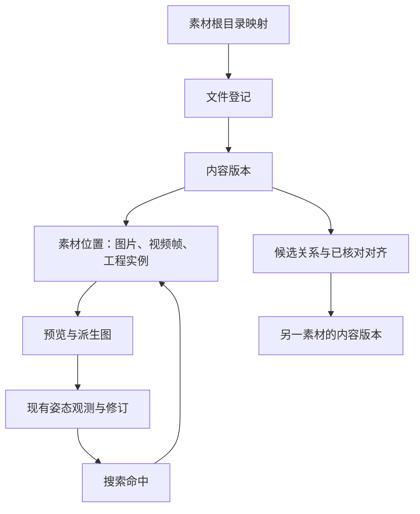

# 多格式编目与搜索结果定位：详细实施规划

2026-10-12。状态：**详细规划，功能尚未实施**。用户已明确本轮方向：编目应方便接入 MP4、FLA 等多种素材；搜索结果应方便找到原文件及文件内的位置。本方案沿用[素材利用总方案](方案卡-2026-10-11-FLA素材利用.md)及既定方向标注规则，将“入目录到找回原素材”列为第一轮交付主线。

## 1. 用户最终如何使用

**加入一个素材文件夹 → 自动识别文件及配套关系 → 从可预览素材建立姿态 → 搜索相似姿态 → 直接查看命中画面，并定位到原素材的相应位置。**

一个入口接收混合格式，处理能力按文件分别显示。可以先查已编目的素材，尚未获得方向的素材显示“暂无姿态”，获得方向后再加入姿态搜索。自动标注、工程取方向和训练可以逐步接入这条流程。

在同一个工作台中安排三个入口：

| 入口 | 用户完成什么 | 主要内容 |
|---|---|---|
| 素材库 | 找文件、预览、选择要处理的材料 | 剧集/镜头、文件格式、素材用途、角色线索、处理进度、原文件位置 |
| 姿态工作台 | 查看和修正选定角色的方向 | 复用现有标注、审核、版本和多物种功能，增加来源位置面板 |
| 搜索结果 | 找相似姿态并取回素材 | 候选图、命中角色、方向比较结果、原文件、精确程度、定位按钮 |

“素材库”的名称/标签搜索与“姿态搜索”分别标明。没有姿态的文件仍可在前者找到，不因入目录成功而自动具备姿态搜索能力。

## 2. 已有基础与本轮核对

现有多物种工作台支持图片、方向、审核、修订、搜索及训练导出；搜索结果当前仅展示部分来源文字、时间秒数及“查看此记录”。工程证据字段已有，但没有统一素材目录和真实来源定位器。

原素材探查确认 15,486 文件，含 6,791 FLA、1,138 MP4、391 MOV、6,451 JPG、715 SWF；3,112 个现代 FLA 主文档可读，旧 OLE 尚未转换。此前 39 组同名角色文件有 32 组内容不同；同名视频/FLA 也可能差帧。详细原始证据见[2026-10-11 接入探查](../开发/验证记录-2026-10-11-素材文件接入探查.md)，这些统计没有在本轮重新全盘扫描。

本轮代码核对发现 `scripts/m01/extract_frames.py` 用 fps 滤镜采样后，以 `round(timestamp_sec * fps)` 填写 `source_frame_index`。这属于估计位置，不能直接提升为新系统的精确源帧。旧 `frame_id` 中的 `_f000` 也不是完整原视频的绝对帧号。

本轮小探针真实解码 `925/ReviewQT/MLP925_020.mp4`，107 帧中序号 26 的展示时间戳为 26026，时间单位为 1/24000 秒，即约 1.084417 秒。按该源帧重新导出的图与前次探查图片 RGB 像素一致，源文件指纹不变。这仅支持一个 H.264 MP4 的定位实例，未验证 FLA 对齐、可变帧率、外部播放器跳转。见[本轮核对记录](../开发/验证记录-2026-10-12-编目定位详细规划.md)。

## 3. 编目流程与格式范围

### 3.1 加入素材

用户选择文件夹或多个文件，也可输入本机路径；建议第一版提供“添加文件夹”“添加文件”和路径输入。拖放在能可靠取得本机路径的外壳中启用；普通浏览器不支持时提供上述入口，不把整个素材目录上传到网页请求。

默认采用“引用原位置”：原素材留在原目录，程序只保存目录信息、预览缓存、派生图片和标注。可后续提供明确的“复制到管理目录”，保留原路径与复制关系；不默认复制 52.95 GiB，也不搬动或改名原件。新增素材目录、排除规则、缓存位置由用户可见设置管理，不要求每个文件重复设置。

执行顺序：

1. **快速登记**：遍历路径、大小、修改时间，识别格式；很快展示目录列表和数量。扩展名与实际文件类型分别记录，探测失败按单文件显示。
2. **背景补齐**：逐项读尺寸、时长、视频流、FLA 主文档/库信息，生成少量预览；已登记文件继续可浏览。
3. **建议关联**：同目录、同镜头名、文件命名约定形成视频/工程/缩略图候选组，显示依据。用户可批量确认“属于同一镜头”，但这不确认帧对应或角色身份。
4. **按需深处理**：选中的文件才做精确取帧、角色裁剪或工程试验。长期大批处理显示队列、完成量、失败项和预计输出空间；支持暂停、继续、只重试失败项。
5. **进入姿态库**：选定图片中的一个角色，建立来源绑定，再复用现有方向标注/模型待审入口。一帧多人分别登记，保留各自框与身份。

扫描重跑只更新变化项。程序关闭后能继续；异常文件不会让整个文件夹失败。第一版手动点“重新扫描”，自动文件监听留到扫描稳定后。

### 3.2 格式支持按能力写清楚

“能入目录”“能预览”“能精确定位”“能提取工程方向”分开判断，不用一个“已支持”概括全部能力。

| 格式 | 第一轮编目与预览 | 第一轮能给的位置 | 工程方向/后续能力 |
|---|---|---|---|
| MP4、MOV、MKV | 文件/流信息、封面、片段预览、选帧；按具体编码解码成功与否判断 | 原文件＋已索引的视频流＋源帧号＋源时间戳 | 图片标注或视觉模型；MOV 可能是分镜，内容用途另记 |
| JPG、PNG、静态 WebP | 尺寸、方向信息、缩略图、原图 | 原文件＋图中角色框/裁剪区域 | 直接接现有图片工作台 |
| ZIP/XML 型 FLA | 主文档、场景、库元件、图层及存储关键帧；已有配套视频/小图可作预览 | 文件位置立即可用；工程场景/帧可由已核对的定位记录提供 | 存储关键帧查询不是原生画面；真实渲染及方向提取是后续能力 |
| OLE 型旧 FLA | 文件与版本、配套预览关联、格式状态 | 文件位置；已有可靠外部定位可保留 | 对少量副本原生转换后再处理，旧文件和新版关联且各保留版本 |
| SWF | 头信息、配套 FLA 关联、文件位置 | 文件位置 | 首版不执行内容，不承诺逐帧导出；需要时再添加经过验证的读取器 |
| XFL 文件夹 | 首版识别为一个复合素材并登记清单；预览/解析标待验证 | 文件夹位置；结构能力另验 | 未来复用 XML 读取，版本指纹覆盖依赖清单，不能只哈希 DOMDocument |
| 图片序列、GIF/动画 WebP、其他工程文件 | 首版可登记文件；不支持的能力说明原因 | 文件或文件夹 | 后续格式读取器增补。序列须明确排序、缺帧与帧率；不默认 24 fps |

本机解码能力以实际探测为准，MP4 不是一种固定编码。浏览器播不了而本机能解码时，提供缓存代理视频或精确帧图；代理文件始终指向原始来源，不能把代理的帧号直接当原文件帧号。

### 3.3 用户看到的状态

- 文件可用性：可访问、离线、找不到、内容已变、读取失败。
- 处理进度：已登记、可预览、有姿态，以及失败原因；这些能力可以并存。
- 定位精度：仅文件、时间附近、精确视频帧、工程主帧、工程角色实例。
- 关联可信度：候选、已确认同镜头、已核对具体对应；姿态审核仍是独立状态。

这些状态应在需要行动的位置展示。比如“FLA 仅可定位文件，尚未核对工程帧”，而不是要求用户理解内部解析器报错。

## 4. 搜索结果必须给用户什么

### 4.1 结果卡

每张卡包含候选图、角色范围标记、相似度与覆盖范围、是否需要翻转、来源文件名、位置和可用按钮。分数仍由现有方向算法计算；格式、文件可打开与否不暗中改变姿态相似度。

以下为**界面示意，位置来自真实探针，但没有为该帧生成或评定姿态分数**：

```text
无序 · 相似度由检索计算 · 原方向 / 需翻转
[候选角色图]  [展开完整画面]

视频：MLP925_020.mp4
位置：第 27 帧 · 00:01.084417（从 1 计；该视频内位置）
[查看命中帧] [播放附近] [定位文件] [复制位置]

关联工程：MLP925_020.fla
同名镜头候选；工程帧和角色实例尚未核对
[定位工程文件] [查看关联依据]
```

FLA 已核对后，其位置面板显示场景名称、主时间轴帧和角色路径；按需展开每级元件的局部帧。视频时间、主时间轴帧、子元件帧各带标签，绝不只写“第 27 帧”而不说明属于谁。

同一角色出现的场景图、裁剪图、已对齐工程渲染可放在同一卡的不同来源页签中。只有确认同一出现后才合并；同名候选不能自动合并。同一镜头邻近但不同的姿势仍是不同命中，首版不按时间粗暴去重。

### 4.2 按钮的明确含义

| 按钮 | 完成的事 | 不能保证时如何表现 |
|---|---|---|
| 查看命中帧 | 内置面板显示与定位记录绑定的源帧，支持前/后一帧，完整画面标出命中角色 | 只有估计时间时改为“查看附近画面”；源文件丢失但有缓存时标明缓存和来源不可用 |
| 播放附近 | 从目标时间附近播放上下文，可切回静帧核对 | 播放器跳转可能只到附近，精确帧以单独解码的静帧为准 |
| 定位文件 | Windows 文件夹内选中对应原素材 | 文件已移动时进入重定位；只到文件夹不能显示成选中文件成功 |
| 打开素材 | 交给本机已配置程序打开 | 不声称外部播放器已跳到某帧；工程操作需要副本时明确显示副本路径 |
| 复制位置 | 复制文件路径、文件内帧/时间、场景/实例路径和精确程度 | 未知项明确写未知，不补零或猜帧率 |
| 在 Animate 定位 | 原生连接可用且已验证时，打开对应版本的工作副本，跳转场景/帧，必要时进入实例 | 第一版没有此能力时不显示为可用；“已打开文件”与“已回读确认位置”分别反馈 |
| 导出命中清单 | 导出可阅读表格与完整 JSON，包括源版本、位置、匹配范围和翻转 | 导出保留原位置及核对状态，不仅导出预览图路径 |

“复制位置”至少提供这种可单独使用的文本：原文件绝对路径、视频流编号、从 1 计的帧号、片内时间、对应状态；FLA 则含场景、主帧、实例层级和局部帧。精确数据同时保存在机器可读记录中，避免只剩四舍五入后的时间文本。

正常可用来源的操作目标：从结果卡查看命中静帧一次点击；定位原文件最多两次点击；复制完整位置一次点击。无需先打开原始 JSON 或在长目录里再次搜索。大文件首次解码可异步等待，等待进度不计作定位成功。

### 4.3 筛选和排序

保留角色、物种、比较范围、审核、翻转与整肢交换选项。增设格式、剧集/镜头、来源集合、“原素材当前可访问”“有精确位置”“有关联工程”筛选；关联工程区分已核对与候选。

默认仍按姿态得分、覆盖度和稳定编号排序。可选择仅看原素材可用结果；来源不可用也能保留历史姿态记录并标明原因。同一出现的多种预览不是多份独立高分结果；合并后按所显示的那份姿态证据说明分数来源。

## 5. 核心数据结构：文件、位置、姿态相互关联

继续使用既有身体定义、方向语义、标注修订和审核记录。新增“来源目录”和“素材位置”，让图片观测能回到来源。



| 记录 | 必要内容 | 约束 |
|---|---|---|
| 素材根目录 | 稳定编号、本机路径、显示名、包含/排除规则 | 路径是本机配置，移动根目录可重绑定 |
| 文件与内容版本 | 文件编号、位置列表、原文件名、格式、SHA-256、版本、观测时间 | 路径与内容身份分开；同名不同内容不合并，同内容可共享读取缓存但不抹去各自剧集/路径信息 |
| 素材分组 | 作品/剧集/镜头/设计素材、来源线索、确认状态 | 文件名推断可修改；同名也可能多版本或多份不同素材 |
| 素材位置 Locator | 位置类型、源版本、具体坐标、精确程度、验证方法 | 所有帧号都必须属于明确的版本和时间轴 |
| 派生图 | 图片指纹、输入位置、裁剪/缩放/旋转变换、生成参数和工具版本 | 从角色裁剪能回到完整画面；不把缓存路径当唯一来源 |
| 姿态来源绑定 | 观测编号、修订编号、图片编号、位置编号、角色出现编号、框/变换 | 图片变更须新建观测；补来源不自动升级方向审核 |
| 关联与对齐 | 两端源版本、关系类型、证据、逐项或区间映射、状态 | 同镜头、同帧和同角色是不同关系，不能一键确认全部 |
| 处理任务 | 输入版本、阶段、能力要求、参数、进度、错误、输出 | 按输入版本＋参数＋工具版本幂等，重复执行不重复入库 |

未知字段使用 null，缺失原因单列。姿态得分、标签审核、来源定位可信度各自保存，避免“方向正确”被当作“工程对应正确”。

### 5.1 视频帧位置

至少保存：`source_version_ref`、`stream_index`、`presentation_ordinal0`、`pts`、`time_base`、时间戳来源、解码方法/版本、派生图指纹。帧序是**在选定视频流中按展示顺序输出、未经抽帧删帧的帧序**，不是压缩包序号、DTS、抽样图序号或内嵌时间码。

例子中的数值来自本轮实测，编号是示意，不是生产库记录：

```json
{
  "example_only": true,
  "kind": "video_frame",
  "source_version_ref": "example:MLP925_020:known-sha256",
  "stream_index": 0,
  "presentation_ordinal0": 26,
  "timestamp": {"value": 26026, "time_base": [1, 24000], "basis": "pts"},
  "precision": "frame_exact",
  "display_frame1": 27,
  "related_fla_alignment": null
}
```

`display_frame1` 为展示派生字段，不单独维护。内存和文件里从 0 计，界面统一从 1 计并标注规则。片内时间由原时间戳减去已记录起始基准得到；媒体内嵌时间码独立显示，未知时不从帧率反推。

抽样时在改变帧率、选择子集之前捕获原帧序和时间戳；输出图片与其元数据同批绑定。FFmpeg 官方文档支持读取逐帧信息，showinfo 可报告输入帧序和展示时间戳；具体参数组合仍要用本机版本验证。[ffprobe 文档](https://ffmpeg.org/ffprobe.html#Main-options)、[showinfo 文档](https://ffmpeg.org/ffmpeg-filters.html#showinfo)。

可变帧率、非零起点、重复时间戳、多视频流都不能只用“秒数乘平均帧率”。若时间戳缺失，可保留明确解码序号及方法，但时间显示未知；若连帧序都未验证，只能是时间附近。为速度从关键帧附近开始解码时，需要已建立的完整帧索引/检查点映射，否则不能把局部计数当全片序号。

内置播放器用于看动作，精确帧面板用于核对位置。代理转码/缩放另有 source-to-proxy 映射；没有验证映射时只拿代理播放附近，不沿用其帧号。

### 5.2 FLA 位置

至少保存源版本、场景标识及名称、主帧；要定位角色，再保存父子实例链和每级局部帧。链中每段带所属时间轴、图层索引、存储关键帧起点、元素或组内路径、实际引用元件、可用原始 ID、播放模式；这些值只在对应源版本有效。

区分两类位置：

- **场景中的实例**：主帧如何沿层级到达角色和部件。
- **库元件画法**：某个库元件的局部帧，可能是模板姿态或未用画法；没有主场景时不补一个虚构主帧。

只解析 XML 时可展示存储的时间轴信息，不能自动宣称任意补间帧、相机和遮罩均已还原。只有真正核对的实例状态能绑定到搜索画面。主帧、子帧、视频帧分别存储。

### 5.3 图片与角色区域

静态图片位置是文件＋图中区域，没有必要硬编一个“第 1 帧”。保存原图尺寸、EXIF/显示方向、角色框或多边形、原图到标注图的变换；选择角色时保留完整画面上下文。图片序列后续按“文件夹版本＋成员文件＋成员序号”定位，不能把排序索引猜成视频时间。

## 6. 视频与 FLA 如何配对

先建立候选关系，再逐步确认：

1. 文件名和目录形成“疑似同镜头”，可供导航。
2. 确认同一镜头或导出版本，仍不默认逐帧对应。
3. 对具体帧和角色进行核对，保存视频位置到工程位置的映射及裁剪/画面变换。
4. 批量映射可表示为区间、分段或逐帧表，标明已核对范围和例外。少数抽样通过不提升整个镜头为全量精确对应；需要更多状态或原生同次导出证据。

925/020 的视频比 FLA 多一近黑帧属于必须显式处理的例外，不能简单裁掉所有视频的末帧。同一镜头可能有多份预览和多个 FLA 修订，关系是多对多。

通过映射从视频帧跳转工程时，还要核对命中的是哪个角色实例。若只有场景对齐而人物不明，可定位主帧，但不能显示“已选中无序”。

## 7. 文件搬家、修改与缓存

- 根目录搬家：改根路径映射，检查原相对路径和内容指纹；恢复来源不改历史标注。
- 单文件重命名/移动：根据指纹在用户登记的根目录内找候选，展示新旧位置后重绑定。多个同内容副本都保留路径，不静默丢掉镜头信息。
- 源内容改变：新建内容版本；旧位置、对齐、渲染缓存和方向提取不能自动套到新版本。旧图和标注仍可查看，明确来源已变。
- 文件暂时离线：记离线，不因一次扫描未找到就删除记录。继续显示已有预览；原文件定位按钮提供修复入口。
- 扫描/解码过程中源文件变化：本次结果标过期并重排队，禁止把前半旧内容与后半新内容组成同一版本。
- 缓存可清理与重建；人工标注、来源绑定、校准和对齐证据不是缓存。导出清单保留路径和版本信息。

首次快速扫描不阻塞于全盘哈希。后台或深处理前取得内容指纹；版本身份未确认前不能形成跨文件去重结论。精确定位前复核来源版本；高成本的哈希/解码异步进行并复用同一任务内已冻结的验证结果，不把时间/大小相同当完整内容证明。

## 8. 模块划分与持久化

按 codebase-design 的 Module / Interface / Adapter 思路，用户界面只认识“素材”“位置”和“可执行操作”；不同格式的识别、取帧和坐标转换由内部 Adapter 完成。

| Module | 对外 Interface（拟议） | 内部职责 |
|---|---|---|
| SourceCatalog | 登记输入、增量扫描、查询素材、重绑定位置 | 版本、目录、去重依据、配套候选、任务状态 |
| MediaAccess | 检查能力、枚举位置、生成指定位置的预览 | 视频/图片/FLA/未知格式 Adapter；流式/分页返回，不要求一次解码全库 |
| SourceLocator | 描述位置、解析当前原文件、执行允许的定位操作 | 版本验证、精确程度、Windows 文件定位、播放器/Animate 接入 |
| PoseIngest | 由派生图和位置建立/关联姿态观测 | 角色框、出现身份、来源证据、幂等导入、旧库衔接 |
| SearchPresentation | 将姿态命中补全为可用结果卡 | 位置文案、来源页签、操作能力、导出；评分继续复用现有模块 |

这些是拟议模块名，不是已有可调用功能。格式 Adapter 只需实现实际支持的能力，未知格式可仅提供基础登记。缺能力必须返回明确原因，不使用通用成功值。

生产 FLA 读取代码应收在项目模块内，不能长期依赖本机技能目录的绝对路径。把已实测的容器读取、长度/CRC 校验和 DOMDocument/LIBRARY 解析行为提取为受测 Adapter，明确保留非场景 XML 与解析错误清单；原生播放仍是另一项能力。

建议新来源目录采用 **SQLite 文件数据库**：适合本机、低写入并发的场景；大量文件、帧位置、关联与任务状态需要索引和原子更新。现有姿态 JSON 修订库继续使用原存储，通过稳定编号连接。选择依据是项目使用方式和关系查询需求，并非已做本项目性能基准。[SQLite 官方适用场景](https://www.sqlite.org/whentouse.html)。

比较：继续每项独立 JSON 便于手看，但关联查询、任务抢占和唯一性检查会散落在程序中；把全部数据重迁到数据库会扩大改动范围。推荐只给新来源目录使用 SQLite，并支持导出 JSONL/完整备份；数据库不包含原视频或 FLA 二进制。第一版安排一个队列写入者，渲染/探测完成后短事务提交，后台工作不长时间占用写锁。

拟议目录：

```text
data/source_catalog_v1/catalog.sqlite   文件、版本、位置、关联、任务正本
data/source_catalog_v1/backups/         一致性备份与可读导出
cache/source_media/                    可重建封面、代理视频、精确帧
outputs/source_jobs/                   任务清单、错误和核对结果
work/source_copies/                    按需生成的工程工作副本
data/pose_library_v2/                  既有图片、姿态修订、审核资料
```

跨两种存储导入采用可恢复任务：先生成派生图并校验，再写姿态修订，最后提交来源绑定；任务保存稳定导入编号，重启核对已完成产物，避免重复记录。查询只呈现完整提交的绑定。数据库与标注一起备份；缓存清理不影响正本，重建检索缓存必须绑定原标注修订和规则版本。

本地网页操作沿用现有 Host/Origin/会话校验。请求提交记录或操作编号，由服务端解析登记路径；不接受前端拼接任意 shell 命令。路径通过真实路径检查，文件操作只在登记根及生成目录内进行。这里是保证“打开的是正确素材”的实现约束，不作为日常用户的额外确认流程。

## 9. 对现有代码的改动位置

| 位置 | 计划改动 | 验证重点 |
|---|---|---|
| `scripts/common/source_catalog/`（新） | 上述目录、位置、格式读取和任务模块 | 小 Interface 的完整业务行为与明确错误 |
| `scripts/m12/catalog_sources.py`（拟新增 CLI） | 扫描、状态、查询、导出、重定位的命令入口 | 与网页复用模块，命令重复执行不造重复项 |
| `scripts/m11/pose_workbench.py` | 素材查询、任务、预览、来源绑定和定位操作入口 | 版本/路径校验，大文件按路径本地读取，耗时工作异步 |
| `scripts/m11/web/` | 素材库入口、来源面板、结果卡和处理进度 | 从结果到原文件/目标帧的实际操作 |
| `scripts/common/multispecies/records.py`、`library.py` | 可选位置引用与来源修订校验，保持旧记录可读 | 仅补来源不改方向审核；改图像仍需新观测 |
| `scripts/common/multispecies/matching.py` | 保留现有评分，必要时返回来源关联编号 | 加定位功能不改变固定集合下的姿态分数 |
| `scripts/common/multispecies/importers.py` | 补接旧来源，明确旧帧号为估计，能核对后再升级 | 不伪造帧、实例和对齐 |
| `scripts/m01/extract_frames.py` | 新编目视频链使用可追溯抽帧；旧入口迁移后调用同一读取能力 | 采样图序号与源视频帧不能混淆，保留旧文件 |
| 旧 M09 结果导出 | 后续复用同一位置文案与可读导出 | 离线报告在未运行工作台时仍有路径和位置文本 |

补来源时生成新修订并保存旧值。对于旧记录，只知道片内秒数就显示“约此时间”；找不到原视频时仍可查看原裁剪，明确回溯范围。若从旧框标注及原始帧清单核对回链，应保存实际依据；不能解析一个文件名就标为精确。

## 10. 实施顺序：先做可用的完整流程

| 阶段 | 交付内容 | 完成条件 | 依赖/规模 |
|---|---|---|---|
| A：来源与位置基础 | 数据库/导出格式、不可变版本、位置类型、独立测试样本 | 同名异内容、搬家、内容更新、未知帧等行为正确 | 不依赖 Animate；小 |
| B：多格式目录 | 混合文件夹扫描、单项错误、配套候选、预览与重扫 | 现有全清单可登记；抽样格式能力正确，重扫不重复 | A；中 |
| C：视频/图片到姿态 | 可追溯取帧、选角色、来源绑定、旧来源迁移报告 | 从 MP4 选中一帧/角色，产生可回溯观测 | A/B；中，含帧定位探针 |
| D：搜索到素材 | 结果卡、精确帧面板、文件定位、复制位置、清单导出 | 一次姿态查询能回到正确原文件、帧及角色区域 | A—C；中 |
| E：FLA 具体位置 | 场景/实例位置、少量原生画面对齐、可用时 Animate 跳转 | 一个短镜头中视频和工程位置确实对应；未知关系不误显示 | A/B/D；原生能力待验，投入不确定 |
| F：工程方向及规模化 | 20—30 状态校准、方向提取、缓存/批量处理、后续训练比较 | 方向与定位双重核对，收益和审核成本有依据 | E 与既有总方案 |

**第一版完整目标是 A—D，并同时把 FLA 作为可编目、可定位文件的来源纳入 B/D。** FLA 的任意实例精确跳转与自动取方向分别由 E/F 验证，不能拖住 MP4/图片的整条可用流程。也不先只做后台扫描而把结果定位留到最后。

开发次序按实际依赖进行，每一阶段交付可独立验收的程序行为。这里的投入是相对工作量，不是未经验证的日期承诺；E 的具体时长取决于原生工具和嵌套播放验证。

## 11. 必须验收的场景

1. 混合文件夹含 MP4、MOV、FLA、JPG、SWF 和未知文件，均能编目并正确显示各自能力；单项损坏不阻塞其他项。
2. 重复扫描、暂停重启、失败重试不重复登记或重复导入姿态。输入在处理期间变化时不混版。
3. 两份同名 FLA 内容不同，保持独立；同内容多路径仍能回到所选剧集/文件位置。
4. 本轮 MP4 第 27 帧能重新取得同一画面，并能前后逐帧；首帧、末帧及越界有明确行为。
5. 独立合成样本覆盖可变帧率、非零起点、多流、重复/缺失时间戳和抽样帧；任何不能证明精确的位置降级而非猜测。真实源文件只读，不用改素材制造测试条件。
6. 旧 `_t..._f000` 标签不会误显示成全片第 1 帧；估计位置显式显示“约”。
7. 925/020 的视频/工程差帧保持例外；同名、同帧数和少量抽样不自动升级为完整对齐。
8. 一帧多个角色，从候选裁剪回到完整画面能指出正确区域；工程对齐后也能区分具体实例。
9. FLA 多层嵌套的主帧与局部帧分别显示；库画法没有主场景时不虚构主帧。原生按钮须区分打开与实际定位回读。
10. 文件搬家、离线、内容更新时，缓存结果仍能解释来源状态；不会打开另一份同名新文件并宣称精确命中旧版。
11. 搜索结果可复制完整位置、选中原文件、查看目标帧；固定候选集合下，接定位功能前后方向得分一致。
12. 保留方向审核、完整角色/遮挡区分、翻转默认关闭和兼容整肢交换规则。新来源不会自动变成已审核训练样本。

实际检查记录通过数、失败项、定位精度、从结果到原文件所需操作、首次/重复扫描耗时、缓存空间和失败重试情况。目录和位置正确并不代表识别准确率提高，后者留给独立训练/检索评估。

## 12. 本轮明确的选择与后续接续

用户已决定：多格式方便编目、搜索结果方便定位原素材及位置。本文给出的原位置引用、统一位置记录、内置精确帧面板、SQLite 新目录与 A—D 首版范围是沿此方向的推荐实现方案，保存不等于功能已经完成。

当前不需要用户补充每个文件的角色或帧率才能开始目录建设。导入时先保留未知，后续按实际使用补充。未来真正需要逐项确认的是角色语义、工程帧对应及新的身体定义，代理先准备可审核材料。

下一次授权实施后从 A 开始，先用独立夹具把版本与位置规则做通，再接 B—D 的真实混合素材流程。现有自动标注与工程取方向继续以同一来源记录为基础，避免以后为追溯文件再重做数据结构。

## 13. 交互预览接续（2026-10-12）

用户随后要求编写预览 HTML，模拟真实程序的导入、搜索场景。已提供 [单文件交互预览](../docs/source-workflow-prototype/index.html)，以 12 个真实文件和内嵌画面驱动内存中的演示状态。

可体验混合导入、暂停/续传、单项失败重试、重复文件跳过、素材库筛选、姿态搜索、逐帧查看、原文件定位示意、复制位置及目录搬家。三个引导演练分别覆盖完整主线、工程未对齐和原目录离线。无序样本的 107 帧及时间戳来自真实视频，穗龙查询使用可见角色的第 115 帧；搜索分数、姿态草图与处理结果为预设演示。

这轮落实的是界面和流程预览，未实施 A—F 后端、工程精确跳转或新模型。39 项浏览器交互检查通过，不能据此认定真实批量编目或识别准确率通过。详见 [验证记录](../开发/验证记录-2026-10-12-编目搜索交互预览.md)。后续实际实施状态见下一节。

## 14. 代码实施接续（2026-10-12）

用户随后明确要求“进行代码实施”。A—D 首版主流程已接入现有工作台：来源 SQLite、持久化任务、格式适配、视频精确画面/图片、角色框与观测绑定、结果来源卡、附近播放、文件定位请求、复制/导出及根目录改绑。原姿态评分和审核沿用既有模块；没有训练模型或自动批准方向。

实际存放位置收拢为 `data/pose_library_v2/sources/catalog.sqlite3` 与同目录 `cache/`，便于与姿态修订一起备份；CLI 指定的独立资料库采用同样结构。可读目录快照为 JSON，搜索清单另有 CSV/JSON。不是原规划中分散的几处拟议目录，也尚无一键完整恢复器。

同名候选优先同一根目录，兼容用户分别登记 ReviewQT 与 scenesetups 的情况，亦可列其他已登记根中的同名项；全部保持未核对，不自动认定对应关系。FLA 生产读取已经复制为项目自身的受测能力，包括本批素材需要的本地 ZIP 记录读取和 CRC 核对，不依赖技能目录脚本。

本轮 338 项相关自动检查及 40 项浏览器检查通过；9 份真实原素材只读抽样，386 份旧观测只读兼容检查。未做全量素材入库性能验证；文件管理器只验证到定位调用，未回读选中状态。旧 AI 审核界面缺 OpenCV/Tcl 的限制单列在[实现记录](../开发/验证记录-2026-10-12-多格式编目与来源定位实现.md)。[操作说明](../docs/source-catalog.md)可直接用于新版工作台。

E/F 继续待做：工程画面与嵌套实例位置、视频/FLA 对齐、Animate 精确跳转、工程方向校准与后续训练评价。旧 M01/M09 未批量迁移，旧来源只报告确知线索；完整图层资格仍需明确的工程对齐证据。
