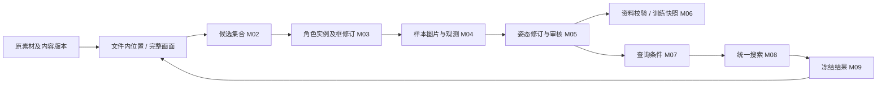

# 将素材与标注工作台纳入 M01—M10

2026-10-13 接续。状态：**A—E 已实施；C／D／E 已在独立副本验收**。

C 接入多格式素材、持久候选、角色框修订和样本关系；D 接入独立点位、方向派生、模型建议审核、快照及三种训练器；E 切换单一原生导航、共同命令和任务，退出旧浏览器及日常旧标签写入。正式标签／模型保留，旧数据接续入口在 M06；本轮迁移只在副本执行。[现行操作](../docs/module-workflow.md)、[C／D／E 验证](../开发/验证记录-2026-10-13-模块化合并CDE.md)说明测试与限制。下文现状检查作为 10 月 12 日的设计依据保留。

用户目标：把“素材与标注工作台”并入原有模块化体系，避免同时维护两套体系。已确定使用 M10 原生界面。本方案继续沿用[多物种设计](方案卡-2026-10-11-多角色多物种数据结构.md)、[素材编目与定位方案](方案卡-2026-10-12-多格式编目与结果定位.md)和现行标注规则；本轮源码与数据检查见[探查记录](../开发/探查记录-2026-10-12-模块化体系合并.md)。

## 1. 建议决定：保留模块分工，统一其背后的数据和处理入口

**保留 M01—M10，把现有工作台拆回这些模块；以现有多物种姿态库及来源目录作为共同基础。** 原生窗口、模块按钮、批处理命令都调用同一套处理逻辑，不再分别修改旧标签文件和新库。

“一套体系”具体指：

- 一个当前项目和资料库设置；剧集、角色、物种是筛选条件。
- 同类数据只有一个正式写入入口；所有编辑入口读到同一份修订。
- 一套标注及审核规则、一套日常搜索实现、一份搜索结果记录。
- 一套任务记录和状态展示；耗时工作仍可使用独立进程。
- 一套原生界面组件；M05、M07 和 AI 审核共用编辑组件。

这不要求把所有东西放进一个文件或一个数据库。来源目录适合 SQLite，标注沿用不可覆盖的 JSON 修订；两者按稳定编号关联，共同组成一个项目资料库。

不建议的路线：继续在原工作台外面加按钮；把新方向标注反写成猜出来的旧关键点；长期做两套正式库的双向同步；另写一个包住所有旧程序的总服务而保留内部重复逻辑。上述做法都会留下持续维护成本。

主要取舍：旧目录与旧界面不能继续担任日常写入入口。回退应切回一个冻结版本及其独立资料副本，不能让新旧两套同时写同一批数据。此方案不涉及删除唯一资料。

## 2. 现在实际上有几套路径

| 现状 | 代码证据 | 合并时的处理 |
|---|---|---|
| M10 目前有“素材与姿态工作台”和“原有模块与 AI 工具”两个主标签 | `scripts/m10/control_center.py::_build_ui` | 最终变成一套模块导航与共享工作区域 |
| 原 M01—M09 依赖剧集、角色目录及 CSV/JSON 文件传递 | `_MODULE_SCRIPTS`、`check_module_status` 及各模块路径构造函数 | 保留模块职责，替换实际取数、写入和状态判断 |
| 新原生工作台使用 `Library + SourceCatalog + SourceService` | `scripts/m10/workbench_model.py` | 保留已有能力，拆出界面状态和共同业务操作 |
| 网页与原生工作台共用底层库及匹配器，但搜索组织、导出和界面各有代码 | `scripts/m11/pose_workbench.py` 与 `workbench_model.py` | 先统一业务操作，再退役完整网页编辑应用 |
| 检索存在旧姿态向量、`pose_record_v1`、`pose_observation_v2` 三条入口 | `m08/search_similar_poses.py`、`m08/search_pose_records.py`、`common/multispecies/matching.py` | 最终日常使用多物种匹配器；中间格式成为迁移输入 |
| AI 审核仍调用旧 M03/M05 保存函数；训练仍读取旧框和关键点文件 | `control_center.py` 的审核函数、`dataset/export_datasets.py` | 与新库标注、框选和训练快照一起迁移 |
| M12 编目命令尚未纳入原模块表 | `scripts/m12/catalog_sources.py` | 编目归 M01；旧命令可保留为调用同一能力的兼容入口 |

因此，网页和原生工作台不是各有一套底层算法；真正的断层是旧流水线与新资料库，以及界面层重复的业务组织。

本轮只读检查：新库有 **386 份当前观测、386 份修订**，其中原正式 49、实验待审 335、查询 2；原关键点文件为 37＋12 条。386 条迁移证据中的来源文件 SHA-256 均与当前文件相符。本次未发现这些迁移来源发生字节变化，但这不等于新旧算法评分完全一致。386 条记录均未绑定新的 `locator_ref`，现存图片和旧时间信息需要按精度保留，不能迁移时补成“精确原视频帧”。

## 3. 合并后的模块分工

| 模块 | 用户看到的名称 | 正式负责的事 | 吸收哪些已有能力 |
|---|---|---|---|
| M01 | 素材登记与画面获取 | 登记多格式文件、读取能力、抽样/精确取帧、预览、源位置 | 旧视频抽帧＋工作台素材页＋M12 编目 |
| M02 | 候选筛选 | 保存选中、排除、待判断的画面集合；人工筛选和 AI 候选建议 | 旧候选筛选、全帧扫描的候选部分 |
| M03 | 角色与框选 | 一幅画面中的多个角色实例、身份/形态、框、质量判断及框建议审核 | 旧框选＋工作台角色框＋AI 框审核 |
| M04 | 样本生成 | 按已知来源及框生成角色图片，保存变换与来源关系，处理重新裁剪 | 旧裁剪＋`SourceService.import_observation` 的裁剪入库能力 |
| M05 | 姿态标注与审核 | 方向、可选点位、部位存在性、视角、身份、逐项审核和历史 | 原生方向编辑＋旧点位编辑＋AI 姿态审核 |
| M06 | 姿态资料准备 | 按明确规则从点位派生方向、校验可检索性、管理派生缓存、制作训练快照 | 旧向量生成＋新库验证/快照＋旧训练资料导出 |
| M07 | 查询设置 | 选查询姿态、比较范围、权重、翻转、身份及来源筛选，保存查询条件 | 旧查询模块＋工作台搜索条件；编辑复用 M05 |
| M08 | 相似姿态搜索 | 按冻结的查询及候选修订进行比较，生成可重现的搜索记录 | 统一为现有多物种匹配器及共同搜索操作 |
| M09 | 结果与素材定位 | 显示命中、完整画面、附近片段、来源位置；导出 CSV/JSON/离线 HTML | 旧结果页面＋工作台结果页及来源定位 |
| M10 | 主窗口与任务管理 | 当前项目、模块导航、共同上下文、任务状态、日志和设置 | 现有总控和工作台外壳 |

模块是职责划分，不是用户每次都必须点九次。素材页可以连续完成 M01—M04；直接添加角色图片可以跳过候选筛选，使用整图建立样本；已画好的方向无需先生成一份旧关键点文件；搜索页可以一次完成 M07—M09。

FLA 能编目不等于能生成角色样本。没有实际画面或已核对工程位置的素材停在相应能力状态，不能强行流入 M04。未来工程方向读取接入 M01 的素材能力和 M05 的证据入口，不再开第三个工作台。

## 4. 原生 UI 的目标形态

建议采用“左侧模块导航＋右侧工作区＋底部任务”的单窗口结构，沿用现有控件实现：

```text
项目 / 素材集合 / 角色与形态筛选                       任务状态
┌─────────────────┬──────────────────────────────────────┐
│ 素材 M01—M04    │ 当前模块的列表、图片、编辑或结果面板  │
│ 标注 M05       │                                      │
│ 资料准备 M06   │ 操作指向同一个素材、样本及标注修订    │
│ 搜索 M07—M09   │                                      │
│ AI 与训练      │                                      │
├─────────────────┴──────────────────────────────────────┤
│ 任务：正在处理 / 需审核 / 已完成 / 失败及重试          │
└────────────────────────────────────────────────────────┘
```

导航分组可以展开到原模块编号，保留熟悉的分步操作。AI 与训练是跨模块任务的集中入口：框预测归 M03、姿态预测及审核归 M05、训练资料归 M06，模型训练仍由 `scripts/ai/` 执行，不再保存另一套标签。

切换“查询”和“库标注”只改变编辑用途，使用同一个姿态编辑组件。选现有样本做查询不会把它从正式库改成查询库；新建的仅供查询图片仍单独标记，默认排除训练。切换项目、样本或关闭窗口时，共用未保存检查；后台结果只能更新其所属项目，避免切换项目后写错库。

原生界面还需补齐旧工具的点位模式、连续标注、缩放、缺失项、批量建议和再次审核等实际能力，不能因为当前方向面板能打开就认定旧编辑器已全部替代。

## 5. 数据如何合成一套

### 5.1 保留的基础

继续使用 `data/pose_library_v2/` 的身体目录、图片资产、观测和修订；保留其内 `sources/` 的素材目录及缓存。第一阶段不改目录名、不重编已有 ID。



原素材路径不是标签 ID；源文件内容版本、文件内位置、角色出现、裁剪图片、标注修订分别保留。剧集号降为可选来源信息，未知角色可先用通用身体形态。

### 5.2 现有新库尚缺的能力

| 需要补充的记录 | 最小内容与约束 |
|---|---|
| 候选集合与判断 | 稳定集合编号、素材位置、选择/排除/未定、判断来源和版本；未框选的画面也能保存 |
| 角色区域修订 | 同一画面可有多个实例；原图坐标中的框、身份/形态、质量及审核依据；不以“帧＋角色名”唯一确定一只角色 |
| 区域到样本关系 | 源位置、区域修订、裁剪变换、图片指纹、观测编号；同一操作重复执行不重复入库 |
| 有定义的点位标签 | 点位 schema 及版本、坐标、可用性/缺失原因、证据、审核；与任意箭头参考点分开 |
| 建议及其处理记录 | 模型/模板/插值来源、输入版本、预测内容、接受/修改/拒绝及对应正式修订；旧输入上的建议能标过期 |
| 查询与搜索记录 | 查询修订、比较定义及权重、筛选条件、候选修订清单或其快照引用、算法版本、命中及原始位置 |
| 共用任务记录 | 所属项目/模块、输入版本、参数、进度、错误、输出引用与重复执行识别值 |

现有 `SourceService` 把选择区域、裁剪和新建观测作为一次导入操作，并没有完整的“先筛选，稍后框选，批量确认后裁剪”数据层。M02/M03 需要真实持久化记录，不能只给当前 UI 临时框换一个名称。

优先沿用当前 SQLite 存储承载目录、选择和任务记录，并补充可核对、可回退的结构升级程序；现代码只检查目录版本为 1，尚无完整升级流程。正式标注继续追加修订，查询和搜索结果保存冻结记录。实施时按第一条完整流程补字段，避免一次建设尚无用途的通用工作流数据库。

### 5.3 标注和坐标的硬约束

- **方向仍是检索主体。** 有定义的点位是可选标注类型，箭头的两个参考点是另一回事；仅有方向不能倒推唯一的一组点位。
- 旧点位模型仍能使用已核实的 schema 点位训练。不能把新画的任意箭头终点当作旧 21 点模型的标签，尤其尾巴表达初始方向，终点不是固定尾尖位置。
- 同一方向保留当前采用的值及其来源。改点后派生方向须指明规则及点位修订；已有直接标注发生冲突时显示差异，不静默覆盖。只改箭头方向会使不再一致的参考点失效。
- 改框产生新的区域修订；像素范围改变后建立新图片/观测，并关联确实相同的角色出现。旧标注不能原封不动贴在新裁剪上。可验证的坐标转换只能生成待审新修订。
- 部位不存在、被遮挡、还没标、无法判断分别保存；来源与审核状态分开。迁移和模型预测不自动升级审核。
- 方向为主，视角/位置辅助；翻转默认关闭，整条兼容肢体交换默认允许。近远或解剖身份有依据才填写。
- 工程里有可核对的完整角色时按完整信息检索；仍保留成片可见性和工程证据。工程存在图层不等于方向已取得。训练使用与监督任务一致的画面。

### 5.4 迁移与回退

1. 建立旧标签、框、候选、图片、查询、模型及新库的数量/指纹清单；保留已有迁移来源 ID。
2. 在独立资料副本执行增量迁移。已迁入且未变化的记录跳过；遇到新库人工修订或旧来源变化，列为冲突，不按修改时间直接覆盖。
3. 迁入尚未覆盖的候选、框及 schema 点位。原点位已保存在 `legacy.reference_points` 的部分作为有来源的迁移输入，核对后进入正式点位结构，不直接把 `annotation.reference_points` 当成同一类型。
4. 对照方向、缺失项、身份、审核、图片绑定及来源精度；旧采样编号保持估计位置，准确绑定另做核对。
5. 一个模块的替代流程通过验收后，关闭该模块旧写入入口。批处理命令也要同步改路由，防止绕过 M10 继续写旧库。
6. 全部切换后，旧 CSV/JSON 仅作归档或带来源版本的兼容导出。只有能无损表达的数据才允许导出旧格式，不能为兼容伪造点位。

回退保留冻结版本和资料副本；合并后产生的新修订继续留存。切回旧程序不会自动获得新格式能力，也不得覆盖新数据。目录中的原图片若仍被引用，要继续保留；“停用旧体系”不等于删掉原图。

## 6. 算法、训练和任务的共同入口

### 6.1 一份查询、一份结果

M07 保存查询条件，M08 消费这些条件并冻结本次参与的修订，M09 展示和导出同一份结果。当前网页导出会重新搜索，而原生导出使用上一次结果，合并后统一为“导出当前看到的那次结果”。

结果至少包含查询及候选修订、身体目录指纹、比较规则及算法版本、实际权重和筛选、得分、覆盖情况、整肢对应、镜像状态以及源位置。素材搬家后的最新可访问路径可以额外解析，但不能改写当时的源内容身份和帧位置。

日常搜索以现有 `multispecies.matching` 为基础。原 M08 和中间 `pose_record_v1` 入口转为导入/命令兼容，旧评分实现在退出日常路径后只保留必要的历史复现实验入口。

旧 `v1/v2` 表示整腿/方向级算法，`pose_observation_v2` 表示保存格式，两者不可混用。迁移旧权重与参数须给出明确映射；不能等价的参数要说明，不可静默忽略。比较验收用固定查询和固定候选集解释排序变化，**不要求不同评分规则算出相同分数，也不把换架构解释成准确率提高**。

现阶段先保留逐条精确比较。资料规模和实测延迟证明有必要后，再增加可重建的搜索缓存；不因名称有“向量”就立即引入向量数据库。M06 的缓存必须绑定标注修订、规则和参数，改标签后不能继续显示旧产物为有效。

### 6.2 同一批资料支持不同模型任务

训练入口统一从冻结快照取数，按任务导出三类标签：角色框、schema 点位、直接方向。每类分别统计可用/排除数量和原因；某张图只有方向时可以参加方向训练，不能参加缺少点位监督的点位训练。

模型声明支持哪些身体及方向/点位定义、输入坐标、预处理和模型文件指纹。框预测进入 M03，点位及直接方向预测进入 M05 待审记录。模板映射、相邻帧插值也是建议来源，沿用同一审核生命周期，不另外维护“AI 正式标签”。

复用现有 `scripts/ai/` 检测、点位训练及方向实验中可复用的训练代码，逐个改为读取统一快照。原实验脚本和固定评估集可以留存，但不能继续承担生产标签写入。当前方向快照导出尚不等于可直接训练全部模型，此处是明确的补齐工作。

公平比较时冻结共同图片范围、可比方向、镜头/素材族分组和训练预算；模型只读取适合自身任务的监督。未审核、查询图、缺图和规则草案按各自规则排除或隔离。同镜头、同图片或复用角色素材不能跨训练/评估集合泄漏。结构整合不预设直接方向模型更优，也不在本轮重训模型。

### 6.3 一个任务入口，保留合理的执行方式

复用并扩展已有持久任务机制；扫描、取帧、裁剪、推理、训练都能在 M10 查看同一张任务列表。重复请求按输入版本、参数及处理器版本识别；恢复、重试不能重复创建标签或漏掉正式输出。

文件解码和 AI 训练仍可使用子进程，UI 绘制与控件更新留在主线程。暂停、取消、继续分别声明能力：扫描可以暂停后继续，尚无训练断点能力时明确显示“可停止，需重新开始”，不能统一显示一个无法兑现的“继续”。切换项目和关闭窗口时按实际运行任务处理。

模块状态改为当前范围中的事实：已登记多少、待框选多少、待审核多少、可检索多少、哪些产物过期、失败为何。不能再以某个输出文件存在就判定整个模块完成。现代码 M02 输入与输出路径相同，以及 M06/M07 状态检查未随版本选项完整变化，均随统一状态读取一起处理。

## 7. 代码归属与最终退役目标

| 当前位置 | 目标 |
|---|---|
| `common/multispecies/` | 保留为身体定义、姿态修订、审核、匹配和方向快照的实现；补有定义的点位及兼容迁移 |
| `common/source_catalog/` | 保留格式读取、文件版本、位置和恢复能力；样本生成复用现有导入事务 |
| `m01`—`m09` | 保留模块入口；同模块的 UI 和命令行调用同一个业务操作，逐个撤去自行拼路径和直接写正式旧文件的代码 |
| `m10/control_center.py` | 缩为主窗口、模块注册、导航和任务展示；移出审核写入、搜索组织和训练取数 |
| `m10/native_workbench.py` | 按素材/框选、姿态编辑、查询/结果拆成可复用视图，不再作为拥有独立生命周期的小应用 |
| `m10/workbench_model.py` | 草稿、当前选择等留给编辑会话；搜索、导出、训练组织迁到共同操作入口 |
| `m11/pose_workbench.py`、`m11/web/` | 原生替代验收后退出日常维护；过渡期只修迁移阻断问题，不再两边补功能 |
| `m12/catalog_sources.py` | 保留必要命令兼容，调用 M01 相同能力；不再代表另一套独立产品流程 |
| `dataset/export_datasets.py`、`ai/` | 读取新库冻结的相应任务快照；复用训练算法，退役直接依赖旧标签目录的生产路径 |
| 三套搜索及重复结果导出 | 合为一个搜索操作和一个结果导出实现；旧适配入口不内置第二套新业务规则 |
| `run_pose_workbench.bat` | 退役网页后可转为打开 M10 的相应模块，兼容用户已有快捷方式 |

可以新增小型 `common/workflow/` 承载当前确实缺少的项目上下文、模块登记、候选/区域生命周期、查询/结果及任务协调。**不要求每个编号再包一层服务类。** 已有库能完整处理的动作直接复用；新入口要真正负责校验、存储及失败恢复，不能只有转发函数和重复数据副本。

内部调用方向固定为“界面/命令入口 → 共同业务操作 → 存储和算法”。业务操作不导入 Tk 或网页处理器，M10 不通过导入旧 GUI 文件来获得正式保存逻辑。独立打开一个模块时也挂载同一视图组件。

旧 M09 离线 HTML 是结果导出格式，可以保留；它与需要维护浏览器状态、编辑和服务端接口的完整 M11 应用性质不同。

## 8. 建议实施顺序与每步交付

| 阶段 | 具体交付 | 通过条件 |
|---|---|---|
| A：资料盘点与共同项目入口 | 迁移清单、冲突报告、隔离副本、唯一项目/库设置、模块登记和能力清单 | 现有 386 条身份不变；旧框/候选/点位数量可对账；未知或冲突项有去向；不动正式原件 |
| B：先打通标注到结果 | M05 共用保存；M07 查询记录；M08 统一搜索；M09 冻结结果及导出；共同状态通知 | 从 M05 改方向，M07/M08 立即读到该修订；导出与所见结果相同；历史只读和并发保护仍有效 |
| C：接入素材与筛选链 | M01 多格式入口；M02 候选持久化；M03 多实例框修订；M04 裁剪和来源；耗时工作接任务列表 | 混合文件进入库→选帧→框角色→标注→搜索→回原文件及位置；重复导入、改框、失败恢复均可核对 |
| D：合并旧编辑能力与 AI | 共用编辑器的 schema 点位模式；框/点位/方向建议审核；M06 统一训练快照及旧训练器适配 | 新库新增且审核的标签能被对应训练导出读到；只有方向的样本不生成伪点位；旧人工点位和审核记录保留 |
| E：切换主 UI 并收尾 | 单一模块导航、全部状态/任务接入、兼容命令、旧写入封口、网页退役、说明更新 | 日常导入/标注/搜索/训练取数都不依赖另一套正式标签；源码入口检查和端到端场景通过 |

推荐 **A→B→C→D→E**。B 的价值是尽早消除“改完标注却搜不到”的核心断层；C/D 对数据关系和旧能力的要求较多，分开验收。每一步都应删除或停用已经替代的重复路径，不能把“最终清理”无限后移。

第一批代码范围应限 A＋B，使用现有样本副本验证。交付须包含真正共用的保存/搜索操作，以及隔离运行中的原模块入口改路由；仅移动标签页或新增一个按钮不算完成。B 先接 M05 的方向模式，旧 schema 点位模式在 D 补齐之前不能宣称整个 M05 已替代。原生产资料暂沿既有写入入口，正式切换前再次核对期间新增的修改；隔离新链路不与原库双向同步。C 前不宣称素材筛选模块已经统一，D 前不宣称 AI 和训练已经统一。

## 9. 最终验收场景

1. **旧资料接续**：原 49 条正式记录保留来源与审核身份；335 条实验记录不自动转正；查询 001 缺原图、002 纯色等问题保留，不能靠新 UI 掩盖。
2. **一次修改处处一致**：M05 修改并保存一条方向，从 M07 选该样本查询，M08 使用同一修订，M09 导出相同命中。保存后改变库数据也不悄悄改写已完成结果。
3. **多格式找回素材**：隔离目录中登记 MP4、图片、现代及旧 FLA；不同格式分别显示实际能力。视频帧号、时间戳、裁剪区域和源版本可追溯；旧估计位置与 FLA 未核对帧继续明确标示。
4. **一帧多角色与重新裁剪**：一帧可建立多个相同或不同角色实例；修改其中一个框不覆盖另一实例，也不挪用旧裁剪的点坐标。
5. **审核及训练闭环**：同一入口接受/修改/拒绝模型建议；只影响审核覆盖的项目。已审核方向能进入方向快照，已核实 schema 点位能进入点位数据，未知/缺失/未审按规则排除。
6. **公平模型比较**：固定图片、分组和预算可分别导出两种监督形式，并回到同一方向口径评价；不以重复模板或邻帧泄漏制造收益。
7. **重复及中断**：双击开始不重复入库，扫描重启可恢复，裁剪失败不出现半成品正式观测，旧窗口不能覆盖较新修订；不能恢复的任务准确说明。
8. **维护成本确实下降**：一个正式标注写入入口、一个日常搜索实现、一个结果导出实现；M10 与命令行通过同一接口测试。旧工作台页、旧保存分支和相应重复测试在替代通过后退出日常维护。

测试使用独立库及最小真实素材副本，优先验证上述用户行为及存储边界。既有测试可保留算法与规则回归证据；退出旧实现后，迁移有效的行为测试到共同入口，不为两套已重复的内部实现永久保留两份维护负担。

## 10. 范围和停点

本方案采用的方向是：保留 M 编号、采用已有多物种资料库、逐步退役独立网页编辑应用、把旧评分留作历史对照。用户随后授权开始实施；随后已授权 C／D／E，并完成代码接入、隔离迁移与旧入口退役；正式库仍由 M06 接续旧资料。

FLA 原生渲染/实例定位、新物种规则实证、扩大标注与重新训练仍是独立业务工作；本轮架构合并为它们提供同一入口，不把这些能力视为已经完成。点位和模型训练器目前明确限于支持的小马结构；工程渲染与新物种模型仍在本轮之外。
